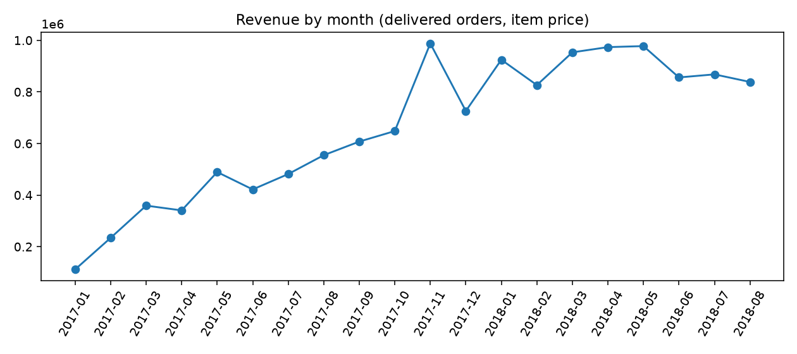
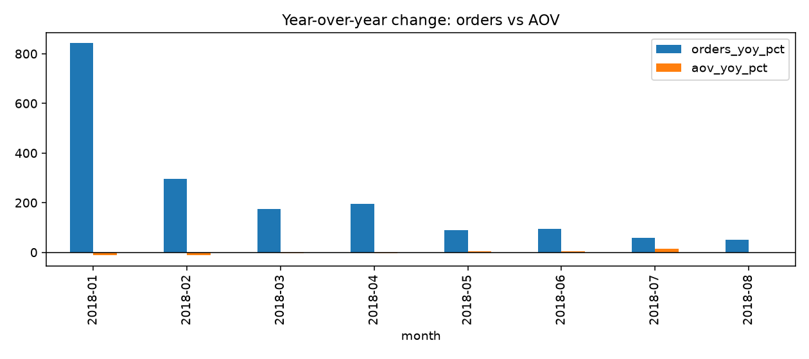
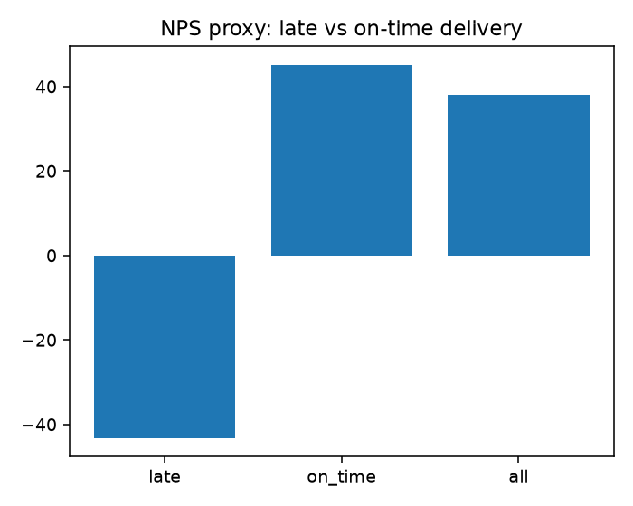
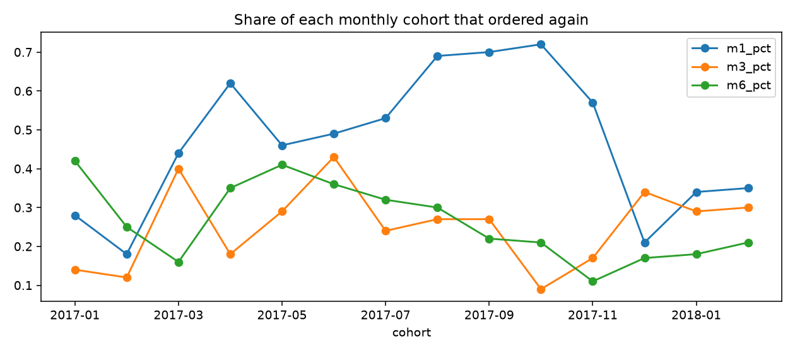

# Olist Business Metrics: what the numbers mean for the business

SQL and Python analysis of the public **Olist Brazilian e-commerce dataset** (about 99,000 orders, Sept 2016 to Oct 2018, amounts in Brazilian reais). It computes the 10 core business metrics (revenue, AOV, gross margin, CAC, LTV, customers, NPS, conversion, retention, churn) and explains what each one means for the business, not just what it is.

**Headline:** Olist's growth came from acquiring new customers, not from bigger orders, and it levelled off after Nov 2017. Only 3% of customers ever buy twice, and late deliveries (concentrated in a few northeastern states and sellers) go with sharply lower reviews. Delivery reliability and a second purchase are the biggest opportunities.

## Key findings

| Metric | Finding |
|---|---|
| Revenue | R$112k (Jan 2017) to R$988k (Nov 2017), then flat at about R$0.83M to R$0.98M a month. Black Friday 2017 alone was about 15% of that month. |
| AOV | Roughly flat at R$125 to R$150: growth came from more orders, not bigger baskets. |
| LTV | About R$165 per customer. Repeat customers are worth R$309 vs R$161 for one-time buyers, but only 3% repeat. |
| Customers | 96,096 real customers (`customer_unique_id`). Counting `customer_id` overstates by 3.5%. |
| NPS (proxy from reviews) | +38 overall: +45 on time, **-43 when late**. 8% of deliveries are late. |
| Late deliveries | Highest in AL, MA, PI, CE, SE and BA (14% to 24% late vs 8% overall). |
| Funnel | 99.8% approved, 98.2% shipped, 97.0% delivered. |
| Retention | 4.9% (2016), 4.2% (2017), 2.0% (2018) ever repeat. The 2018 figure is partly lower because those customers had less time to return. |

## Recommendations
1. Improve delivery reliability where late rates are highest (the six states above and the worst sellers).
2. Test a second-purchase offer after delivery, since repeat customers are worth almost twice as much.
3. Do not rely on bigger baskets for growth; acquire customers efficiently and raise retention.

Full write-up: [SO_WHAT_MEMO.md](SO_WHAT_MEMO.md)

## What the data cannot answer
True gross margin, marketing spend (so no real CAC), true NPS surveys, website conversion, and commissions. The memo says what data to request next. (`q04` in `metrics.sql` uses clearly labelled *assumed* margins and CACs for practice only.)

## Charts

## How to run
1. Download the **Brazilian E-Commerce Public Dataset by Olist** from Kaggle and put the CSV files in `data/` (the data is not stored in this repo).
2. `pip install pandas matplotlib`
3. `python build_db.py` builds a SQLite database and prints row counts.
4. `python run_metrics.py` runs every query in `metrics.sql`, saves a CSV per query and the charts in `outputs/`.

## Files
`metrics.sql` (all queries, each with a plan in plain English and a check), `build_db.py`, `run_metrics.py`, `SO_WHAT_MEMO.md`.

Tools: SQL (SQLite), Python (pandas, matplotlib).
